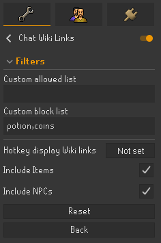
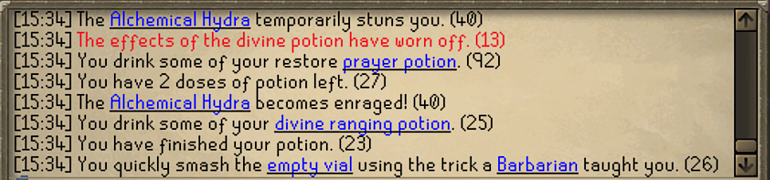

# Chat Wiki Links
A simple Runelite plug-in that highlights game keywords in the OSRS chat and adds a context menu option to open the OSRS Wiki.

Plug-in features:
- Optional parameters for adding or blocking your own keywords.
- Adding a toggle hotkey to dynamically show/hide the wiki hyperlinked words.
- Enable/disable items and/or NPCs being highlighted.

