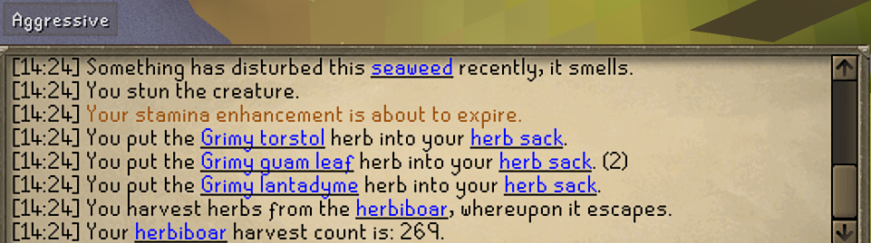
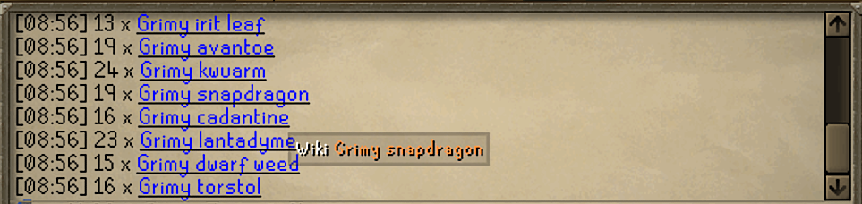

# chat-wiki-links
A simple Runelite plug-in that highlights game keywords in the OSRS chat and adds a context menu option to open the OSRS Wiki.

Plug-in features optional parameters for adding your own keywords, blocking certain words, or adding a toggle hotkey to dynamically show/hide the wiki hyperlinked words.

